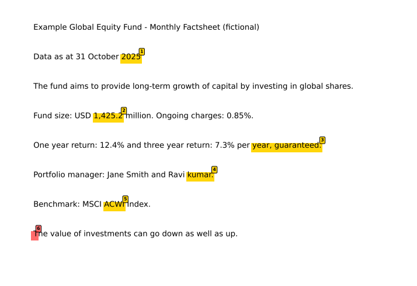
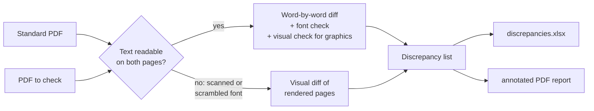
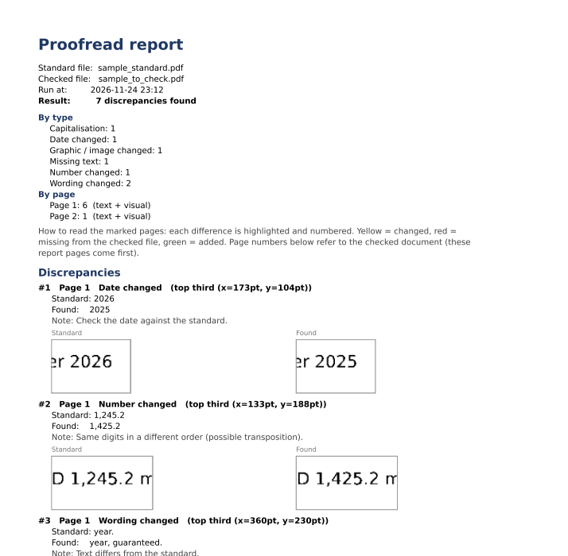

# PDF Proofread Checker

Checks a PDF against its approved **standard** version and reports every difference, with page numbers, in an **Excel log** and an **annotated PDF report**.

**The problem it solves:** marketing and compliance teams re-check client documents (factsheets, brochures, reports) against the approved version by eye. A swapped digit, an old date or a dropped risk warning is easy to miss and costly if it reaches clients.



## What it finds

| Type | Example |
|---|---|
| Number changed | `1,245.2` → `1,425.2` (flags possible digit transposition) |
| Date changed | `31 October 2026` → `31 October 2025` |
| Wording / capitalisation / punctuation | `MSCI World` → `MSCI ACWI`, `Kumar` → `kumar` |
| Missing text | a risk warning removed |
| Added text | `, guaranteed` added |
| Formatting changed | font or size differs on matching words |
| Graphic changed | chart, logo, image or colour differs |
| Missing / added page | page counts differ |

## How it works



- **Readable pages:** words are aligned with a sequence diff, so an insertion doesn't make the rest of the page look different. Each change is classified (number, date, wording, capitalisation, punctuation, missing, added), and font changes on matching words are flagged.
- **Unreadable pages** (scanned, or fonts that extract as gibberish): both pages are rendered at 150 dpi and compared pixel by pixel in colour. Changed areas are grouped into boxes and labelled changed, missing or added.

## Outputs

**`discrepancies.xlsx`**
- *Discrepancies* sheet: #, page, location, standard text, text found, type of change, note, and **image crops of both versions** side by side.
- *Summary* sheet: totals by type and by page.

**`<file>_highlighted.pdf`**
- **Report pages at the front:** summary, every discrepancy with before/after crops, and the validation notes.
- **The checked document**, with each difference highlighted (yellow = changed, red = missing, green = added) and a **numbered tag** matching the report. Hover a highlight for the detail.



## Quick start

```bash
python -m venv .venv && source .venv/bin/activate
pip install -r requirements.txt

# Try it on the fictional sample (6 text errors + 1 graphic change planted)
python make_sample_pdfs.py
python proofread_compare.py --standard examples/sample_standard.pdf \
                            --check examples/sample_to_check.pdf --out examples/output

# Your own files: put the approved PDF in 1_standard/ and the version to check in 2_to_check/
python proofread_compare.py        # results go to output/
```

Your documents in `1_standard/`, `2_to_check/` and `output/` are git-ignored.

## Validation

All of these tests were run during development; the errors were planted by me.

| Test | Result |
|---|---|
| Synthetic factsheet: 6 planted text errors + 1 recoloured graphic | 7/7 found, 0 false alarms |
| Real public fund factsheet (6 pages, unreadable font encoding) vs itself | 0 differences |
| Same factsheet with 8 planted edits (date, 2 figures, a name, a chart bar, a deleted disclaimer, 2 added lines) | 8/8 found and labelled, 0 false alarms |

The real factsheet isn't included in this repo because it belongs to its publisher. `make_sample_pdfs.py` builds a fully fictional equivalent.

## Limitations

- **Unreadable pages:** text added in the middle pushes the rest of the page down, so later lines show up as changed. Readable pages don't have this problem.
- **Reflowed content:** text that moves to another page shows as missing on one page and added on the other.
- **Unreadable text isn't transcribed:** for those pages the report shows image crops instead of text (no OCR yet).
- **PDF only:** save Word or PowerPoint files as PDF first.
- **Small validation set:** planted errors only. The tool hasn't been measured on real-world edits yet.

## Next steps

- OCR for scanned or scrambled pages, so the report quotes the text.
- Smarter page alignment when content moves between pages.
- Batch mode for many document pairs.
